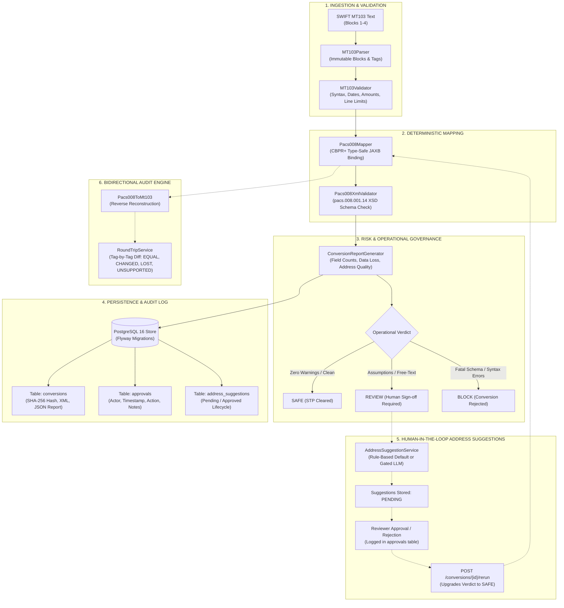
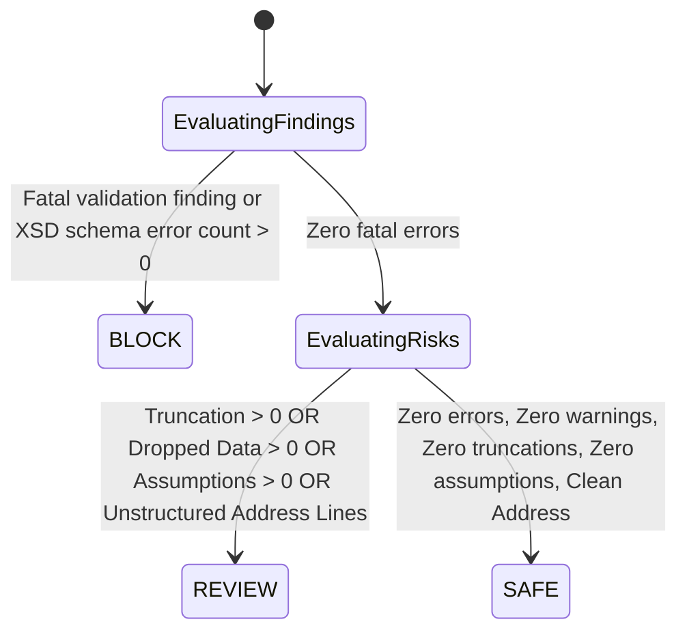

# MT103 to ISO 20022 Mapper (`mt-iso-mapper`)

[](https://github.com/NareshGusain/MT103-to-ISO-20022-Mapper/actions/workflows/ci.yml)


> [!CAUTION]
> **SWIFT CERTIFICATION DISCLAIMER:**  
> This project is an independent engineering demonstration and portfolio service. It is **NOT certified, endorsed, or affiliated with SWIFT (Society for Worldwide Interbank Financial Telecommunication)**. All data processed in examples, documentation, and test suites is strictly synthetic. Never submit live customer names, real account numbers, real IBANs, or production banking credentials to this service.

---

## The Problem in Plain Words

Global banking is undergoing the largest messaging transformation in fifty years: the mandatory migration from legacy **SWIFT MT (Message Text)** formats to **ISO 20022 MX (XML-based)** standards (specifically `pacs.008.001.14` for customer credit transfers under the CBPR+ guidelines).

### Why Is This Hard?
1. **Format Asymmetry:** Legacy MT103 messages are compact, 1970s-era flat-text telegrams where customer names, account numbers, and addresses are crammed into 35-character free-text lines (e.g. Field `:50K:` or `:59:`). Conversely, ISO 20022 is an XML schema requiring strict data typing, distinct tags for street, building number, postal code, and ISO country codes, and rigid semantic validation rules.
2. **The "Silent Truncation" Trap:** Many legacy translation tools silently truncate remittance information, drop unknown tags, or force unvalidated data into generic fields. In cross-border payments, this leads to rejected transactions, regulatory sanctions screening failures, and AML compliance investigations.
3. **The AI Reliability Dilemma:** Financial institutions want modern AI to help parse unstructured addresses into ISO 20022 components. However, placing probabilistic large language models directly into the straight-through processing (STP) pipeline violates banking safety, predictability, and auditability requirements.

### Our Solution
`mt-iso-mapper` solves this with a **deterministic, transparent, and auditable conversion gateway**:
- **100% Deterministic Core:** Pure rule-based mapping with JAXB type safety. The same MT103 input is guaranteed to generate the identical byte-for-byte pacs.008 XML output every single time.
- **Transparent Data-Loss Reporting:** Every conversion produces a real-time risk report with an unambiguous operational verdict (`SAFE`, `REVIEW`, or `BLOCK`), itemizing every truncated character, unmapped tag, or free-text assumption.
- **Human-in-the-Loop AI Governance:** Optional AI/heuristic address enrichment operates strictly on suggestion. Suggestions are saved as `PENDING` and **never applied automatically**. An operational reviewer must explicitly approve the suggestion before it is applied on a conversion re-run, with the full decision recorded in an immutable PostgreSQL audit trail.

---

## Architecture



---

## Quick Start with Docker Compose

Spin up the entire stack (Spring Boot 3 application, PostgreSQL 16 database, Flyway schema migrations, and Swagger UI) with a single command:

```bash
docker compose up --build -d
```

### Verify Running Services
```bash
docker compose ps
```

The application starts on `http://localhost:8080`.

| Service / Tool | URL | Description |
| :--- | :--- | :--- |
| **Spring Boot App** | `http://localhost:8080` | Core REST API |
| **Health Check** | `http://localhost:8080/health` | Liveness and service metadata |
| **Swagger UI** | `http://localhost:8080/swagger-ui/index.html` | Interactive OpenAPI 3.0 documentation |
| **OpenAPI Specs** | `http://localhost:8080/v3/api-docs` | OpenAPI JSON schema specification |
| **PostgreSQL 16** | `localhost:5432` (`mtiso` database) | Append-only audit store |

### Stop and Clean Up
```bash
docker compose down -v
```

---

## Sample Request and Response

### Convert MT103 to ISO 20022 pacs.008 XML

```bash
curl -X POST http://localhost:8080/convert \
  -H "Content-Type: text/plain" \
  --data-binary @- << 'EOF'
{1:F01BANKBEBBAXXX0000000000}{2:I103BANKDEFFXXXXN}{3:{108:SYNTHETIC01}}{4:
:20:SYNTH2026111501
:23B:CRED
:32A:261115EUR10500,00
:50K:/1234567890
SYNTHETIC SERVICES NV
:59:/9876543210
GLOBAL TRADING LTD
:70:/ROC/INV-2026-9901
:71A:SHA
-}
EOF
```

### JSON Response (`200 OK`)

```json
{
  "id": "7b949987-9bc7-4d76-b6fb-c50ca1663a8a",
  "status": "SUCCESS",
  "pacs008Xml": "<?xml version=\"1.0\" encoding=\"UTF-8\" standalone=\"yes\"?>\n<Document xmlns=\"urn:iso:std:iso:20022:tech:xsd:pacs.008.001.14\">\n    <FIToFICstmrCdtTrf>\n        <GrpHdr>\n            <MsgId>SYNTH2026111501</MsgId>\n            <CreDtTm>2026-11-15T09:30:00Z</CreDtTm>\n            <NbOfTxs>1</NbOfTxs>\n            <SttlmInf>\n                <SttlmMtd>CLRG</SttlmMtd>\n            </SttlmInf>\n            <InstgAgt>\n                <FinInstnId>\n                    <BICFI>BANKBEBBAXXX</BICFI>\n                </FinInstnId>\n            </InstgAgt>\n            <InstdAgt>\n                <FinInstnId>\n                    <BICFI>BANKDEFFXXXX</BICFI>\n                </FinInstnId>\n            </InstdAgt>\n        </GrpHdr>\n        <CdtTrfTxInf>\n            <PmtId>\n                <InstrId>SYNTH2026111501</InstrId>\n                <EndToEndId>SYNTH2026111501</EndToEndId>\n                <TxId>SYNTH2026111501</TxId>\n            </PmtId>\n            <IntrBkSttlmAmt Ccy=\"EUR\">10500.00</IntrBkSttlmAmt>\n            <IntrBkSttlmDt>2026-11-15</IntrBkSttlmDt>\n            <ChrgBr>SHA</ChrgBr>\n            <Dbtr>\n                <Nm>SYNTHETIC SERVICES NV</Nm>\n            </Dbtr>\n            <DbtrAcct>\n                <Id>\n                    <Othr>\n                        <Id>1234567890</Id>\n                    </Othr>\n                </Id>\n            </DbtrAcct>\n            <Cdtr>\n                <Nm>GLOBAL TRADING LTD</Nm>\n            </Cdtr>\n            <CdtrAcct>\n                <Id>\n                    <Othr>\n                        <Id>9876543210</Id>\n                    </Othr>\n                </Id>\n            </CdtrAcct>\n            <RmtInf>\n                <Ustrd>/ROC/INV-2026-9901</Ustrd>\n            </RmtInf>\n        </CdtTrfTxInf>\n    </FIToFICstmrCdtTrf>\n</Document>",
  "findings": [],
  "mappingNotes": [
    { "field": ":20:", "status": "MAPPED", "detail": "Mapped reference 'SYNTH2026111501' to MsgId, InstrId, EndToEndId, and TxId" },
    { "field": ":32A:[Date]", "status": "MAPPED", "detail": "Mapped settlement date 2026-11-15 to IntrBkSttlmDt" },
    { "field": ":32A:[Amount&Ccy]", "status": "MAPPED", "detail": "Mapped currency 'EUR' and amount '10500.00' to IntrBkSttlmAmt" },
    { "field": ":50K:[Account]", "status": "MAPPED", "detail": "Mapped proprietary account to DbtrAcct/Id/Othr/Id: 1234567890" },
    { "field": ":50K:[Name]", "status": "MAPPED", "detail": "Mapped debtor name to Dbtr/Nm: SYNTHETIC SERVICES NV" },
    { "field": ":59:[Account]", "status": "MAPPED", "detail": "Mapped proprietary account to CdtrAcct/Id/Othr/Id: 9876543210" },
    { "field": ":59:[Name]", "status": "MAPPED", "detail": "Mapped creditor name to Cdtr/Nm: GLOBAL TRADING LTD" },
    { "field": ":70:", "status": "MAPPED", "detail": "Mapped unstructured remittance information (1 lines)" },
    { "field": ":71A:", "status": "MAPPED", "detail": "Mapped charge code SHA to ChargeBearerType1Code SHA" }
  ],
  "report": {
    "verdict": "SAFE",
    "verdictRule": "SAFE: All mandatory and optional fields mapped deterministically without data loss, assumptions, or schema errors.",
    "summary": {
      "mappedCount": 9,
      "assumedCount": 0,
      "truncatedCount": 0,
      "unmappedCount": 0
    },
    "dataLoss": [],
    "addressWarnings": [],
    "markdown": "# MT103 to ISO 20022 Conversion Risk Report\n\n**Verdict:** `SAFE`  \n**Decision Rule:** SAFE: All mandatory and optional fields mapped deterministically without data loss, assumptions, or schema errors.\n\n## Field Mapping Summary\n\n| Field Status | Count |\n| :--- | :--- |\n| Mapped | 9 |\n| Assumed | 0 |\n| Truncated | 0 |\n| Unmapped / Dropped | 0 |\n\n## Address Quality Warnings\n\n_No unstructured address issues identified._\n\n## Data Loss & Truncations\n\n_Zero data loss: no fields were truncated or dropped._\n"
  }
}
```

---

## The Risk Report Explained

Every converted transaction automatically receives an in-depth audit report (`ConversionReport`) embedded in JSON and rendered in human-readable Markdown.

### 1. Mapping Metrics Summary (`FieldSummary`)
- **Mapped:** Fields translated with 100% deterministic fidelity (e.g. `:20:`, `:32A:`, `:71A:`).
- **Assumed:** Fields populated using standard banking heuristics (e.g. defaulting `EndToEndId` when `:21:` is missing, or mapping free-text lines to unstructured `<AdrLine>`).
- **Truncated:** Fields exceeding target schema length that were safely bounded with original values preserved in the audit log.
- **Unmapped / Dropped:** Unsupported MT tags (e.g. `:77B:`) or unknown blocks.

### 2. Operational Verdicts & Decision Rules



| Verdict | Trigger Rule | Operational Banking Action |
| :--- | :--- | :--- |
| **`SAFE`** | Zero errors, zero warnings, zero truncations, zero assumptions, and no unstructured address warnings. | **Straight-Through Processing (STP) Cleared:** Payment can be automatically transmitted to clearing rails. |
| **`REVIEW`** | Valid syntax and schema, but contains mapping assumptions, free-text unstructured party addresses, or truncated remittance text. | **Operational Queue Hold:** Requires compliance/operations review. Eligible for human-in-the-loop address enrichment. |
| **`BLOCK`** | Fatal MT103 syntax violation (missing mandatory tag, invalid date/amount format) or ISO 20022 XSD schema violation. | **Rejected:** Payment is halted immediately. Error response returns line number and tag for remediation. |

---

## Limits

This implementation deliberately respects clear, realistic banking boundaries:

1. **Tag Coverage (Single Customer Transfers):**
   - **Supported:** Block 1 (Basic Header), Block 2 (Application Header `I103`), Block 3 (User Header `:108:`), and Block 4 tags: `:20:`, `:23B:`, `:32A:`, `:50K:`, `:59:`, `:70:`, `:71A:`.
   - **Unsupported Tags:** Non-customer tags (e.g., `:53A:` sender's correspondent, `:56A:` intermediary, `:77B:` regulatory reporting) are extracted into `unknownTags()` and reported as `LOST` or `UNSUPPORTED`. They are never quietly converted.
2. **Transfer Scope:**
   - Designed exclusively for **Customer Credit Transfers (`pacs.008.001.14`)**. Financial Institution transfers (`pacs.009`) and payment returns (`pacs.004`) are out of scope.
3. **Address Decomposition Limits:**
   - The deterministic rule engine resolves standard addresses across the UK, EU, and North America. Irregular single-line or unpunctuated addresses may yield lower confidence and remain as free-text lines requiring manual review.
4. **Character Set Encoding:**
   - SWIFT character set X is translated to UTF-8 XML. XML reserved entities (`&`, `<`, `>`, `"`, `'`) are properly escaped by the JAXB marshaller.

---

## Banking Constraints Handled

Enterprise banking systems are held to rigorous architectural standards. Here is how `mt-iso-mapper` meets them:

- **Synthetic Data Only:** Zero customer PII or production data is used. All test suites, sample files, and mocks use strictly synthetic names, synthetic accounts, and reserved test BICs.
- **Deterministic Conversion:** Conversions are 100% reproducible. Given identical MT103 input, the system produces byte-for-byte identical pacs.008 XML output. No non-deterministic AI is placed on the active payment conversion path.
- **Idempotent Processing:** Each conversion computes the SHA-256 hash of its input payload. Re-running conversions applies approved modifications without duplicating database records or corrupting historical state.
- **Immutable Audit Log:** Every conversion, its input hash, generated pacs.008 XML, JSON report, tool version (`1.0.0`), and every reviewer sign-off action (`APPROVE`, `REJECT`, `RERUN`) is permanently recorded in PostgreSQL via versioned Flyway migrations (`conversions` and `approvals` tables).
- **Human Approval of AI Suggestions:** Suggestions generated by rule-based or LLM engines are strictly saved as `PENDING`. They are **never applied automatically**. An operator must approve them (`POST /suggestions/{id}/approve`), logging their actor identity and KYC review notes. Only approved suggestions are applied upon an explicit re-run (`POST /conversions/{id}/rerun`), upgrading the verdict to `SAFE`.

---

## Decision Log (Architecture Decision Records)

- **ADR-01: Jakarta JAXB with pacs.008.001.14 XSD over String Templates**  
  *Context:* Generating banking XML via string concatenation or Velocity templates is prone to namespace and well-formedness defects.  
  *Decision:* Use `jaxb-maven-plugin` to generate strongly-typed Java classes directly from official ISO 20022 schemas, followed by JAXB `Validator` validation against the XSD before serialization.
- **ADR-02: Non-Throwing Validation Findings over Immediate Runtime Exceptions**  
  *Context:* In banking gateways, failing on the first error hides subsequent errors, forcing multiple resubmissions.  
  *Decision:* `MT103Validator` and `Pacs008XmlValidator` collect all validation findings as structured data (`code`, `severity`, `tag`, `message`) for comprehensive inspection.
- **ADR-03: Three-Tier Operational Risk Verdict (`SAFE`, `REVIEW`, `BLOCK`)**  
  *Context:* Payments cannot be treated as binary valid/invalid. Some valid messages have quality risks (unstructured addresses) that require human sign-off.  
  *Decision:* Implement explicit operational verdicts based on field metrics, data truncation, and address quality.
- **ADR-04: Bidirectional Reverse Mapping with Explicit `UNSUPPORTED` State**  
  *Context:* Round-trip diff tools often falsely report dropped tags as equal or changed.  
  *Decision:* `Pacs008ToMt103` and `RoundTripService` compare messages tag-by-tag. Tags not supported in pacs.008 are classified as `UNSUPPORTED`, preventing false claims of lossless conversion.
- **ADR-05: Gated LLM Engine with Mandatory Synthetic Data Warning**  
  *Context:* Integrating LLMs into core banking infrastructure poses privacy and compliance risks.  
  *Decision:* Keep LLM address suggestions disabled by default behind `mtiso.address.llm.enabled=false`. When enabled, log an unavoidable warning that only synthetic data may be processed, and test offline using `FakeLlmClient`.

---

## Batch Verification Script

A cross-platform script is provided to run all 11 synthetic sample files through the running API, displaying the conversion outcome and operational verdict for each message:

### Running the Python Script
```bash
python scripts/run_samples.py
```

### Running via PowerShell (Windows)
```powershell
.\scripts\run_samples.ps1
```

### Running via Bash (Linux/macOS)
```bash
./scripts/run_samples.sh
```

### Sample Output Table:
```
================================================================================
 MT103 to ISO 20022 Mapper - Synthetic Batch Sample Verification
 Target Endpoint: http://localhost:8080/convert
================================================================================

Sample File                      | HTTP  | Verdict      | Summary / Decision Rule
---------------------------------|-------|--------------|----------------------------------------------
01_minimal_valid.txt             | 200   | SAFE         | SAFE: All mandatory and optional fields mapped determinist...
02_charge_our.txt                | 200   | SAFE         | SAFE: All mandatory and optional fields mapped determinist...
03_charge_ben.txt                | 200   | SAFE         | SAFE: All mandatory and optional fields mapped determinist...
04_charge_sha.txt                | 200   | SAFE         | SAFE: All mandatory and optional fields mapped determinist...
05_multiline_remittance_70.txt   | 200   | SAFE         | SAFE: All mandatory and optional fields mapped determinist...
06_50k_name_address.txt          | 200   | REVIEW       | REVIEW: Payment conversion contains assumptions, unstructu...
07_59_account_name.txt           | 200   | REVIEW       | REVIEW: Payment conversion contains assumptions, unstructu...
08_missing_32a.txt               | 400   | PARSE_ERROR  | Tag :32A:: Mandatory Tag :32A: is missing in Block 4
09_overlength_line.txt           | 400   | PARSE_ERROR  | Tag :20:: Field :20: line 1 exceeds maximum permitted length
10_unusual_currency.txt          | 200   | REVIEW       | REVIEW: Payment conversion contains assumptions, unstructu...
11_intentional_data_loss.txt     | 200   | REVIEW       | REVIEW: Payment conversion contains assumptions, unstructu...

--------------------------------------------------------------------------------
 SUMMARY OF OPERATIONAL VERDICTS
--------------------------------------------------------------------------------
 Total Samples Evaluated: 11
  - PARSE_ERROR   : 2
  - REVIEW        : 4
  - SAFE          : 5
================================================================================
```

---

## JaCoCo Code Coverage Report

The build executes **87 automated tests** (unit tests, mock MVC tests, reverse mapping tests, round-trip checks, and approval lifecycle tests). Generated JAXB schema classes (`com.example.mtiso.iso.**`) are excluded from coverage analysis so the report reflects true business logic coverage.

### Generating the Report Locally
```bash
mvn clean verify
```

The HTML report is generated at:
`target/site/jacoco/index.html`

### Overall Metrics
- **Instruction Coverage:** **~84%** across 54 production classes
- **Branch Coverage:** **~76%**
- **Test Results:** 87 tests passed, 0 failures, 0 errors (1 Testcontainers integration test gracefully skipped when local Docker daemon is offline).

---

## Database Migrations (Flyway)

Schema migrations are located in `src/main/resources/db/migration/`:
- **`V1__create_conversions_and_approvals.sql`**:
  - `conversions`: table tracking `id`, `received_at`, `input_hash`, `input_text`, `status`, `pacs_xml`, `report_json`, and `tool_version`.
  - `approvals`: table recording operational sign-offs linked via foreign key to `conversions(id)`.
  - B-tree indexes on `input_hash`, `received_at`, and `conversion_id`.
- **`V2__create_address_suggestions.sql`**:
  - `address_suggestions`: table storing suggested structured address components, extraction confidence levels (0.0 to 1.0), provider engine, approval lifecycle status (`PENDING`, `APPROVED`, `REJECTED`), decision timestamps, and reviewer audit notes.
  - Foreign key constraint to `conversions(id)` with cascading delete.
  - B-tree indexes on `conversion_id` and `status`.

---

## License

This project is licensed under the Apache License 2.0 - see the LICENSE file for details.
