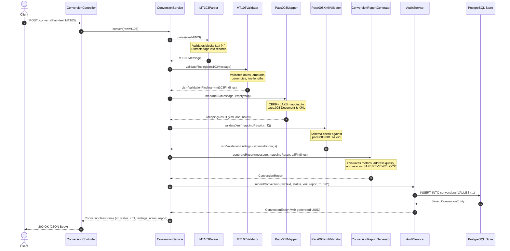
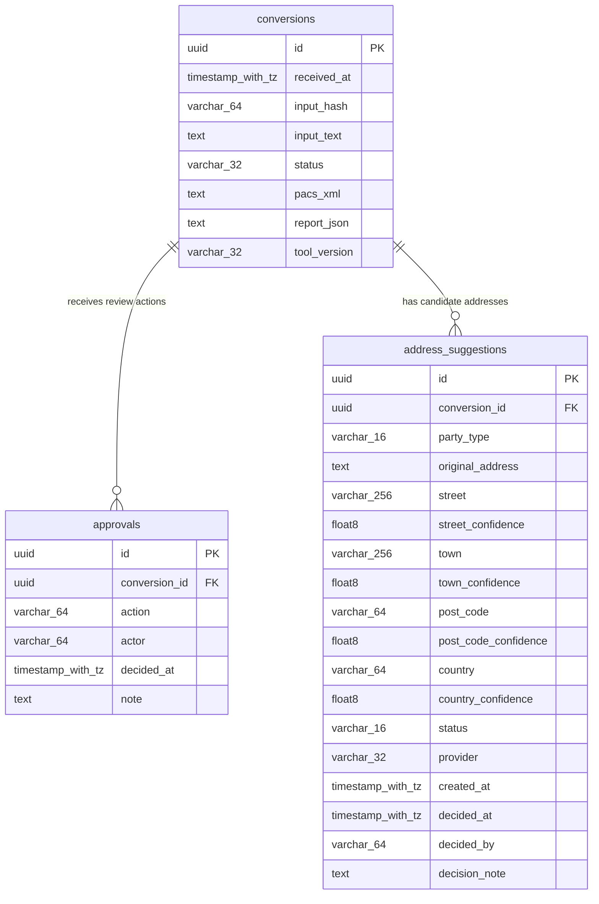

# Architecture and Implementation Guide: MT103 to ISO 20022 Mapper (`mt-iso-mapper`)

---

## 1. Project in One Paragraph: What It Does and What It Does Not Do

`mt-iso-mapper` is an enterprise-grade Spring Boot 3 financial microservice that converts legacy **SWIFT MT103** (Single Customer Credit Transfer text telegrams) into **ISO 20022 `pacs.008.001.14`** (XML-based financial credit transfer messages) according to global **CBPR+** (Cross-Border Payments and Reporting Plus) guidelines. It validates SWIFT formatting and ISO schema constraints, assesses operational risk by generating an actionable data-loss report with an operational verdict (`SAFE`, `REVIEW`, or `BLOCK`), persists all transactions and operational decisions in an immutable **PostgreSQL** audit log via **Flyway** migrations, offers a bidirectional round-trip verification engine (`MT103` $\rightarrow$ `pacs.008` $\rightarrow$ `MT103`), and provides human-in-the-loop address enrichment where AI suggestions remain in a `PENDING` state until explicitly approved by an operator.  
**What it does NOT do:** It is **NOT** certified by SWIFT, does not connect to live SWIFT Alliance gateways, does not process real money or customer PII (Personally Identifiable Information), does not support multi-transaction batching (every message is processed as a single customer transfer), and does not support institutional bank-to-bank transfers (`pacs.009`), payment returns (`pacs.004`), or direct debits (`pacs.003`).

---

## 2. Directory Tree & Dependency Reference

### Repository Tree Structure

```
d:/MT103-to-ISO-20022-Mapper
├── .github/
│   └── workflows/
│       └── ci.yml
├── docs/
│   └── ARCHITECTURE.md
├── scripts/
│   ├── run_samples.ps1
│   ├── run_samples.py
│   └── run_samples.sh
├── src/
│   ├── main/
│   │   ├── java/
│   │   │   └── com/example/mtiso/
│   │   │       ├── MtIsoMapperApplication.java
│   │   │       ├── address/
│   │   │       │   ├── AddressField.java
│   │   │       │   ├── AddressSuggestion.java
│   │   │       │   ├── AddressSuggestionEntity.java
│   │   │       │   ├── AddressSuggestionManager.java
│   │   │       │   ├── AddressSuggestionRepository.java
│   │   │       │   ├── AddressSuggestionResponse.java
│   │   │       │   ├── AddressSuggestionService.java
│   │   │       │   ├── ApprovalDecisionRequest.java
│   │   │       │   ├── LlmAddressSuggestionService.java
│   │   │       │   ├── LlmClient.java
│   │   │       │   ├── PartyType.java
│   │   │       │   ├── RuleBasedAddressSuggestionService.java
│   │   │       │   └── SuggestionStatus.java
│   │   │       ├── api/
│   │   │       │   ├── AddressSuggestionController.java
│   │   │       │   ├── ConversionController.java
│   │   │       │   ├── ConversionResponse.java
│   │   │       │   ├── HealthController.java
│   │   │       │   ├── HealthResponse.java
│   │   │       │   ├── package-info.java
│   │   │       │   ├── ParseErrorResponse.java
│   │   │       │   ├── RoundTripController.java
│   │   │       │   └── RoundTripResponse.java
│   │   │       ├── audit/
│   │   │       │   ├── ApprovalDto.java
│   │   │       │   ├── ApprovalEntity.java
│   │   │       │   ├── ApprovalRepository.java
│   │   │       │   ├── AuditService.java
│   │   │       │   ├── ConversionDetailResponse.java
│   │   │       │   ├── ConversionEntity.java
│   │   │       │   └── ConversionRepository.java
│   │   │       ├── mapper/
│   │   │       │   ├── ConversionService.java
│   │   │       │   ├── MappingNote.java
│   │   │       │   ├── MappingResult.java
│   │   │       │   ├── MappingStatus.java
│   │   │       │   ├── Pacs008Mapper.java
│   │   │       │   ├── Pacs008ToMt103.java
│   │   │       │   ├── package-info.java
│   │   │       │   ├── RoundTripResult.java
│   │   │       │   ├── RoundTripService.java
│   │   │       │   ├── TagComparison.java
│   │   │       │   └── TagMatchStatus.java
│   │   │       ├── parser/
│   │   │       │   ├── MT103Message.java
│   │   │       │   ├── MT103ParseException.java
│   │   │       │   ├── MT103Parser.java
│   │   │       │   ├── RawTag.java
│   │   │       │   └── SwiftHeaders.java
│   │   │       ├── report/
│   │   │       │   ├── ConversionReport.java
│   │   │       │   ├── ConversionReportGenerator.java
│   │   │       │   ├── ConversionVerdict.java
│   │   │       │   ├── DataLossItem.java
│   │   │       │   └── FieldSummary.java
│   │   │       └── validation/
│   │   │           ├── MT103Validator.java
│   │   │           ├── Pacs008XmlValidator.java
│   │   │           ├── Severity.java
│   │   │           ├── TagLineLimit.java
│   │   │           ├── ValidationFinding.java
│   │   │           └── ValidationResult.java
│   │   └── resources/
│   │       ├── application.yml
│   │       ├── db/
│   │       │   └── migration/
│   │       │       ├── V1__create_conversions_and_approvals.sql
│   │       │       └── V2__create_address_suggestions.sql
│   │       └── xsd/
│   │           ├── pacs.002.001.16.xsd
│   │           ├── pacs.003.001.12.xsd
│   │           ├── pacs.004.001.15.xsd
│   │           ├── pacs.007.001.14.xsd
│   │           ├── pacs.008.001.14.xsd
│   │           ├── pacs.009.001.13.xsd
│   │           ├── pacs.010.001.06.xsd
│   │           └── pacs.028.001.07.xsd
│   └── test/
│       ├── java/
│       │   └── com/example/mtiso/
│       │       ├── address/
│       │       │   ├── AddressSuggestionWorkflowTest.java
│       │       │   ├── FakeLlmClient.java
│       │       │   ├── LlmAddressSuggestionServiceTest.java
│       │       │   └── RuleBasedAddressSuggestionServiceTest.java
│       │       ├── api/
│       │       │   ├── ConversionControllerTest.java
│       │       │   ├── HealthControllerTest.java
│       │       │   └── RoundTripControllerTest.java
│       │       ├── audit/
│       │       │   ├── AuditPersistenceTest.java
│       │       │   └── PostgresTestcontainersIntegrationTest.java
│       │       ├── mapper/
│       │       │   ├── Pacs008MapperTest.java
│       │       │   ├── Pacs008ToMt103Test.java
│       │       │   └── RoundTripServiceTest.java
│       │       ├── parser/
│       │       │   └── MT103ParserTest.java
│       │       ├── report/
│       │       │   └── ConversionReportTest.java
│       │       └── validation/
│       │           ├── MT103ValidatorTest.java
│       │           └── Pacs008XmlValidatorTest.java
│       └── resources/
│           ├── application.yml
│           ├── golden/
│           │   ├── golden_01_minimal.xml
│           │   └── golden_02_charge_our.xml
│           ├── mockito-extensions/
│           │   └── org.mockito.plugins.MockMaker
│           └── samples/
│               └── mt103/
│                   ├── 01_minimal_valid.txt
│                   ├── 02_charge_our.txt
│                   ├── 03_charge_ben.txt
│                   ├── 04_charge_sha.txt
│                   ├── 05_multiline_remittance_70.txt
│                   ├── 06_50k_name_address.txt
│                   ├── 07_59_account_name.txt
│                   ├── 08_missing_32a.txt
│                   ├── 09_overlength_line.txt
│                   ├── 10_unusual_currency.txt
│                   └── 11_intentional_data_loss.txt
├── .gitignore
├── docker-compose.yml
├── Dockerfile
├── pom.xml
└── README.md
```

### Complete File Inventory & Dependency Map

| File Path | One-Sentence Role | Dependencies (What It Relies On) |
| :--- | :--- | :--- |
| `pom.xml` | Maven build descriptor specifying Java 21, Spring Boot 3.3.5, JAXB plugins, JaCoCo, and dependencies. | Spring Boot Starter Parent, JAXB plugin, JaCoCo plugin. |
| `Dockerfile` | Multi-stage container recipe building jar via Maven and executing in Temurin 21 JRE. | `pom.xml`, `src/`. |
| `docker-compose.yml` | Orchestrates the Spring Boot app and PostgreSQL 16 container network with health checks. | `Dockerfile`, `src/main/resources/application.yml`. |
| `.github/workflows/ci.yml` | GitHub Actions workflow executing `mvn -B verify` and uploading JaCoCo reports on push/PR. | GitHub Ubuntu Runner, Maven, JDK 21. |
| `src/main/resources/application.yml` | Production configuration setting database datasource, Flyway, and server port. | PostgreSQL environment variables. |
| `src/test/resources/application.yml` | Test configuration switching database to in-memory H2 with PostgreSQL syntax mode. | H2 database engine. |
| `src/main/resources/db/migration/V1__create_conversions_and_approvals.sql` | Flyway SQL script creating the `conversions` and `approvals` audit log tables and B-tree indexes. | Flyway migration runner. |
| `src/main/resources/db/migration/V2__create_address_suggestions.sql` | Flyway SQL script creating the `address_suggestions` table with FK to `conversions(id)`. | `V1__create_conversions_and_approvals.sql`. |
| `src/main/resources/xsd/pacs.008.001.14.xsd` | Official ISO 20022 XML Schema Definition used by JAXB to generate domain classes and validate XML. | Jakarta XML Binding (JAXB). |
| `src/main/resources/xsd/pacs.002...` to `pacs.028...` | Companion ISO 20022 payment clearing schemas provided for ecosystem completeness. | None (reference XSDs). |
| `scripts/run_samples.py` | Cross-platform Python script posting all 11 synthetic samples to `/convert` and printing verdicts. | Python 3 standard library (`urllib.request`, `json`). |
| `scripts/run_samples.ps1` | Native PowerShell script sending samples to `/convert` and color-coding verdicts. | PowerShell 5.1 / 7+. |
| `scripts/run_samples.sh` | Bash script wrapping `curl` to run sample conversions and display verdicts. | Bash, `curl`, Python 3. |
| `com/example/mtiso/MtIsoMapperApplication.java` | Spring Boot main application entrypoint enabling component scanning and auto-configuration. | Spring Boot framework. |
| `.../parser/RawTag.java` | Immutable Java record modeling a single SWIFT tag name, raw text value, and line list. | Java standard library. |
| `.../parser/SwiftHeaders.java` | Immutable Java record holding parsed Block 1 sender LT, Block 2 receiver LT, and Block 3 tags. | Java standard library. |
| `.../parser/MT103Message.java` | Immutable Java record representing a parsed MT103 with strongly-typed tag accessors and unknown tags. | `RawTag.java`, `SwiftHeaders.java`. |
| `.../parser/MT103ParseException.java` | Runtime exception thrown when SWIFT FIN block delimiters or tag syntax are invalid. | Java standard library. |
| `.../parser/MT103Parser.java` | Deterministic state-machine parser turning raw SWIFT FIN text into an immutable `MT103Message`. | `MT103Message.java`, `RawTag.java`, `SwiftHeaders.java`, `MT103ParseException.java`. |
| `.../validation/Severity.java` | Enum (`ERROR`, `WARNING`) distinguishing fatal conversion blockers from review items. | None. |
| `.../validation/TagLineLimit.java` | Record defining configurable line count and line character length constraints per SWIFT tag. | None. |
| `.../validation/ValidationFinding.java` | Value record capturing a single rule check outcome (`severity`, `code`, `tag`, `message`). | `Severity.java`. |
| `.../validation/ValidationResult.java` | Aggregates validation findings with helper methods checking for errors or warnings. | `ValidationFinding.java`, `Severity.java`. |
| `.../validation/MT103Validator.java` | Validates mandatory tags, dates (`YYMMDD`), currencies (ISO 4217), amounts, and line bounds. | `MT103Message.java`, `ValidationFinding.java`, `TagLineLimit.java`, `Severity.java`. |
| `.../validation/Pacs008XmlValidator.java` | Validates generated XML against `pacs.008.001.14.xsd` and maps schema errors to findings. | `ValidationFinding.java`, `Severity.java`, `pacs.008.001.14.xsd`. |
| `.../mapper/MappingStatus.java` | Enum (`MAPPED`, `TRUNCATED`, `UNMAPPED`, `ASSUMED`) indicating field transformation fidelity. | None. |
| `.../mapper/MappingNote.java` | Record documenting the transformation status and explanatory reasoning for an individual field. | `MappingStatus.java`. |
| `.../mapper/MappingResult.java` | Record holding generated XML, JAXB Document object, and collection of `MappingNote` entries. | `MappingNote.java`, generated JAXB `Document`. |
| `.../mapper/Pacs008Mapper.java` | Deterministic mapper converting `MT103Message` to JAXB `Document` and serializing formatted XML. | `MT103Message.java`, `MappingResult.java`, `MappingNote.java`, `AddressSuggestion.java`. |
| `.../mapper/Pacs008ToMt103.java` | Reverse mapper extracting SWIFT headers and fields from a pacs.008 Document back into raw MT103. | `Document.java`, JAXB pacs.008 classes. |
| `.../mapper/TagMatchStatus.java` | Enum (`EQUAL`, `CHANGED`, `LOST`, `UNSUPPORTED`) tracking round-trip tag fidelity. | None. |
| `.../mapper/TagComparison.java` | Record detailing original MT103 tag, reconstructed tag, values, and `TagMatchStatus`. | `TagMatchStatus.java`. |
| `.../mapper/RoundTripResult.java` | Record holding original message, reverse message, tag comparisons, and lossless status. | `TagComparison.java`. |
| `.../mapper/RoundTripService.java` | Converts MT103 $\rightarrow$ pacs.008 $\rightarrow$ MT103 and runs tag-by-tag diff comparison. | `Pacs008Mapper.java`, `Pacs008ToMt103.java`, `MT103Parser.java`, `RoundTripResult.java`. |
| `.../mapper/ConversionService.java` | Core facade orchestrating parsing, validation, mapping, XML schema check, reporting, and audit. | `MT103Parser`, `MT103Validator`, `Pacs008Mapper`, `Pacs008XmlValidator`, `ConversionReportGenerator`, `AuditService`. |
| `.../report/FieldSummary.java` | Record tracking counts of mapped, assumed, truncated, and unmapped fields. | None. |
| `.../report/DataLossItem.java` | Record documenting specific lost or truncated fields, original vs mapped text, and impact. | None. |
| `.../report/ConversionVerdict.java` | Enum (`SAFE`, `REVIEW`, `BLOCK`) defining the operational decision outcome. | None. |
| `.../report/ConversionReport.java` | Record holding verdict, decision rule, field counts, data loss items, address warnings, and Markdown. | `ConversionVerdict`, `FieldSummary`, `DataLossItem`. |
| `.../report/ConversionReportGenerator.java` | Evaluates validation findings, address structure, and mapping notes to produce `ConversionReport`. | `MT103Message`, `MappingResult`, `ValidationFinding`, `ConversionReport`, `ConversionVerdict`. |
| `.../audit/ConversionEntity.java` | JPA entity mapping to `conversions` table (id, receivedAt, inputHash, inputText, status, xml, report). | JPA annotations. |
| `.../audit/ApprovalEntity.java` | JPA entity mapping to `approvals` table (id, conversion FK, action, actor, decidedAt, note). | `ConversionEntity.java`, JPA annotations. |
| `.../audit/ConversionRepository.java` | Spring Data JPA repository for reading and saving `ConversionEntity` records. | `ConversionEntity.java`. |
| `.../audit/ApprovalRepository.java` | Spring Data JPA repository for reading and saving `ApprovalEntity` records. | `ApprovalEntity.java`. |
| `.../audit/ApprovalDto.java` | DTO representing an approval record for JSON API responses. | `ApprovalEntity.java`. |
| `.../audit/ConversionDetailResponse.java` | DTO returning complete historical conversion audit details and linked approval decisions. | `ConversionReport.java`, `ApprovalDto.java`. |
| `.../audit/AuditService.java` | Manages database persistence, SHA-256 payload hashing, JSON report serialization, and approvals. | `ConversionRepository`, `ApprovalRepository`, `ConversionEntity`, `ApprovalEntity`, Jackson `ObjectMapper`. |
| `.../address/PartyType.java` | Enum (`DEBTOR`, `CREDITOR`) specifying which payment party an address belongs to. | None. |
| `.../address/SuggestionStatus.java` | Enum (`PENDING`, `APPROVED`, `REJECTED`) defining the operational governance state of a suggestion. | None. |
| `.../address/AddressField.java` | Record representing an extracted address string and confidence score ($0.0 \le c \le 1.0$). | Java standard library. |
| `.../address/AddressSuggestion.java` | Record aggregating suggested `street`, `town`, `postCode`, `country`, and `provider`. | `AddressField.java`. |
| `.../address/AddressSuggestionEntity.java` | JPA entity mapping to `address_suggestions` table storing candidate addresses and review state. | `PartyType.java`, `SuggestionStatus.java`. |
| `.../address/AddressSuggestionRepository.java` | Spring Data JPA repository for `AddressSuggestionEntity` queries by conversion ID and status. | `AddressSuggestionEntity.java`. |
| `.../address/AddressSuggestionResponse.java` | DTO returning suggestion details and audit status in API responses. | `AddressSuggestionEntity.java`. |
| `.../address/ApprovalDecisionRequest.java` | Request body DTO for approving or rejecting an address suggestion (`actor`, `note`). | Jakarta Validation. |
| `.../address/AddressSuggestionService.java` | Interface for extracting structured address components from raw free-text lines. | `AddressSuggestion.java`. |
| `.../address/RuleBasedAddressSuggestionService.java` | Deterministic heuristic regex address extractor (default engine, `@Primary`). | `AddressSuggestionService.java`, `AddressSuggestion.java`. |
| `.../address/LlmClient.java` | Interface abstraction for LLM prompt completion providers. | None. |
| `.../address/LlmAddressSuggestionService.java` | LLM-backed suggestion engine gated behind `mtiso.address.llm.enabled` with privacy warnings. | `AddressSuggestionService`, `LlmClient`, Jackson `ObjectMapper`. |
| `.../address/AddressSuggestionManager.java` | Orchestrates suggestion creation, approval auditing, rejection auditing, and re-conversion. | `AddressSuggestionRepository`, `AuditService`, `ConversionService`, `MT103Parser`. |
| `.../api/ConversionResponse.java` | API response DTO holding conversion `id`, `status`, generated `pacs008Xml`, findings, and report. | `ValidationFinding`, `MappingNote`, `ConversionReport`. |
| `.../api/ParseErrorResponse.java` | Structured 400 Bad Request error DTO naming the failing line and SWIFT tag. | None. |
| `.../api/HealthResponse.java` | Response DTO for the `/health` endpoint returning status, version, and UTC timestamp. | None. |
| `.../api/RoundTripResponse.java` | API response DTO returning reconstructed MT103 and tag-by-tag comparison results. | `RoundTripResult.java`. |
| `.../api/ConversionController.java` | REST controller exposing `POST /convert` and `GET /conversions/{id}`. | `ConversionService`, `AuditService`, `ConversionResponse`, `ParseErrorResponse`. |
| `.../api/RoundTripController.java` | REST controller exposing `POST /roundtrip`. | `RoundTripService`, `RoundTripResponse`. |
| `.../api/AddressSuggestionController.java` | REST controller exposing suggestion generation, approval, rejection, and re-run endpoints. | `AddressSuggestionManager`, `AddressSuggestionResponse`, `ConversionResponse`. |
| `.../api/HealthController.java` | REST controller exposing `GET /health`. | `HealthResponse.java`. |
| `src/test/.../FakeLlmClient.java` | Offline in-memory test double for `LlmClient` guaranteeing zero network calls. | `LlmClient.java`. |
| `src/test/.../golden/golden_01_minimal.xml` | Hand-verified pacs.008 XML benchmark for `01_minimal_valid.txt`. | JAXB schema validation. |
| `src/test/.../golden/golden_02_charge_our.xml` | Hand-verified pacs.008 XML benchmark for `02_charge_our.txt`. | JAXB schema validation. |
| `src/test/.../samples/mt103/*.txt` | 11 synthetic SWIFT MT103 test files covering minimal, charge codes, errors, and addresses. | None. |

---

## 3. Package Guide

### Payment Term Glossary for This Section
- **SWIFT FIN**: The core store-and-forward messaging mechanism used by SWIFT to transmit financial MT messages formatted in numbered text blocks (`{1:}` through `{4:}`).
- **Tag**: A 2- or 3-character identifier prefixed and suffixed by colons (e.g. `:20:`) denoting a specific business data field inside SWIFT FIN Block 4.
- **IBAN** (International Bank Account Number): Standardized international bank account format (ISO 13616) beginning with a 2-letter country code.
- **BIC** (Business Identifier Code): Unique 8- or 11-character bank identifier (ISO 9362).
- **Debtor / Creditor**: Payer (Ordering Customer) and Payee (Beneficiary Customer) respectively.

### Package Specifications

```
com.example.mtiso
├── parser       # SWIFT FIN block parsing, tag extraction, syntax checks
├── validation   # Semantic banking rules & pacs.008 XSD schema validation
├── mapper       # Deterministic MT103 <-> pacs.008 JAXB mapping & round-trip diff
├── report       # Risk evaluation, field counters, data-loss tracking, operational verdict
├── audit        # PostgreSQL JPA entities, Flyway migrations, SHA-256 payload hashing
├── address      # AI & rule-based address enrichment, approval lifecycle, KYC audit notes
└── api          # Spring Web REST controllers, OpenAPI 3.0 annotations, error handlers
```

#### 1. `com.example.mtiso.parser`
- **Job:** Deconstructs raw SWIFT FIN text into structured headers (Blocks 1–3) and an immutable collection of Block 4 tags without performing business mapping.
- **Main Classes:**
  - `MT103Parser`: State machine that reads Blocks `{1:}`, `{2:}`, `{3:}`, `{4:}`. Throws `MT103ParseException` if blocks are malformed or missing required tags.
  - `MT103Message`: Immutable record holding Block 1 & 2 headers, strongly typed accessors for tags (`tag20()`, `tag23B()`, `tag32A()`, `tag50K()`, `tag59()`, `tag70()`, `tag71A()`), and a list of `unknownTags()`.
  - `RawTag`: Encapsulates tag name, multiline string value, and individual lines.
  - `SwiftHeaders`: Holds sender and receiver Logical Terminal (LT) addresses.
- **Inputs & Outputs:** `String rawText` $\rightarrow$ `MT103Message` (or throws `MT103ParseException`).

#### 2. `com.example.mtiso.validation`
- **Job:** Executes semantic banking rules on the parsed MT103 and XSD schema validation on generated pacs.008 XML, returning non-fatal structured findings.
- **Main Classes:**
  - `MT103Validator`: Checks presence of mandatory tags (`:20:`, `:23B:`, `:32A:`, `:50K:`, `:59:`, `:71A:`), value date syntax (`YYMMDD`), currency format (3 uppercase letters), decimal amount format (comma separator), charge codes (`OUR`, `BEN`, `SHA`), line counts, and line lengths (e.g. 35 chars).
  - `Pacs008XmlValidator`: Compiles `pacs.008.001.14.xsd` and validates the marshaled XML document.
  - `ValidationFinding`: Value record storing `severity` (`ERROR`, `WARNING`), finding `code`, `tag`, and descriptive `message`.
- **Inputs & Outputs:** `MT103Message` or `String xml` $\rightarrow$ `List<ValidationFinding>`.

#### 3. `com.example.mtiso.mapper`
- **Job:** Executes deterministic transformation from `MT103Message` to ISO 20022 `pacs.008.001.14` XML, reverse mapping (`Pacs008ToMt103`), and tag-by-tag round-trip verification.
- **Main Classes:**
  - `Pacs008Mapper`: Uses generated JAXB classes (`FIToFICustomerCreditTransferV14`, `GroupHeader131`, `CreditTransferTransaction73`) to build the XML Document. Accepts optional approved address suggestions to generate structured postal tags.
  - `Pacs008ToMt103`: Reconstructs raw MT103 text from a pacs.008 Document.
  - `RoundTripService`: Converts MT103 $\rightarrow$ pacs.008 $\rightarrow$ MT103 and performs a tag-by-tag comparison (`EQUAL`, `CHANGED`, `LOST`, `UNSUPPORTED`).
  - `ConversionService`: High-level orchestrator called by the REST API.
- **Inputs & Outputs:** `MT103Message` $\rightarrow$ `MappingResult` (XML string, JAXB Document, list of `MappingNote`).

#### 4. `com.example.mtiso.report`
- **Job:** Analyzes mapping notes, validation findings, truncation items, and address structure to generate an operational audit report and verdict.
- **Main Classes:**
  - `ConversionReportGenerator`: Computes summary metrics (`FieldSummary`), extracts data loss and truncations (`DataLossItem`), checks for unstructured address lines, and evaluates the operational verdict rule.
  - `ConversionReport`: Holds the final verdict (`SAFE`, `REVIEW`, `BLOCK`), verdict rule explanation, metrics, data loss items, address warnings, and formatted Markdown text.
  - `ConversionVerdict`: Enum (`SAFE`, `REVIEW`, `BLOCK`).
- **Inputs & Outputs:** `MT103Message`, `MappingResult`, `List<ValidationFinding>` $\rightarrow$ `ConversionReport`.

#### 5. `com.example.mtiso.audit`
- **Job:** Manages immutable persistence in PostgreSQL, computes SHA-256 payload hashes, serializes JSON reports, and records operational reviewer approvals.
- **Main Classes:**
  - `ConversionEntity`: JPA entity mapped to the `conversions` table.
  - `ApprovalEntity`: JPA entity mapped to the `approvals` table.
  - `AuditService`: Transactional service recording conversions, updating re-runs, and recording approval actions.
- **Inputs & Outputs:** Converted data & reports $\rightarrow$ Persisted database records.

#### 6. `com.example.mtiso.address`
- **Job:** Provides heuristic and AI-assisted address restructuring, lifecycle state management (`PENDING`, `APPROVED`, `REJECTED`), and KYC audit trail recording.
- **Main Classes:**
  - `AddressSuggestionService`: Interface for address extraction.
  - `RuleBasedAddressSuggestionService`: Default deterministic regex extractor for street, town, postal code, and country.
  - `LlmAddressSuggestionService`: LLM-backed implementation gated behind `mtiso.address.llm.enabled`.
  - `AddressSuggestionManager`: Coordinates suggestion creation, status updates, and conversion re-runs.
  - `AddressSuggestionEntity`: JPA entity mapped to `address_suggestions`.
- **Inputs & Outputs:** `List<String> rawAddressLines` $\rightarrow$ `AddressSuggestion` / `AddressSuggestionEntity`.

#### 7. `com.example.mtiso.api`
- **Job:** Exposes RESTful HTTP endpoints with SpringDoc OpenAPI 3.0 documentation and translates domain exceptions into standard HTTP error responses.
- **Main Classes:**
  - `ConversionController`: Exposes `POST /convert` and `GET /conversions/{id}`.
  - `RoundTripController`: Exposes `POST /roundtrip`.
  - `AddressSuggestionController`: Exposes suggestion generation, approval, rejection, and re-run endpoints.
  - `HealthController`: Exposes `GET /health`.
  - `ConversionResponse`, `ParseErrorResponse`: DTOs.
- **Inputs & Outputs:** HTTP requests $\rightarrow$ HTTP responses (`200 OK`, `400 Bad Request`, `404 Not Found`).

---

## 4. Request Walkthrough: Tracing `POST /convert` Step by Step



### Detailed Execution Trace

1. **HTTP Ingestion:**  
   - **Class / Method:** [ConversionController.java:52](file:///d:/MT103-to-ISO-20022-Mapper/src/main/java/com/example/mtiso/api/ConversionController.java#L52) `convert(@RequestBody String rawMt103)`.
   - **Data In:** `rawMt103` (Plain text string containing SWIFT FIN message).
   - **Action:** Passes raw string to `ConversionService.convert(rawMt103)`.

2. **SWIFT Syntax Parsing:**  
   - **Class / Method:** [MT103Parser.java:42](file:///d:/MT103-to-ISO-20022-Mapper/src/main/java/com/example/mtiso/parser/MT103Parser.java#L42) `parse(String messageText)`.
   - **Data In:** `rawMt103` string.
   - **Processing:** Checks and extracts Blocks `{1:}`, `{2:}`, `{3:}`, `{4:}`. Extracts tags delimited by `\n:XX:`. If Block 4 or mandatory delimiters are missing, throws `MT103ParseException` (caught by `ConversionController.handleParseException`, returning HTTP 400 `ParseErrorResponse`).
   - **Data Returned:** Immutable [MT103Message](file:///d:/MT103-to-ISO-20022-Mapper/src/main/java/com/example/mtiso/parser/MT103Message.java).

3. **Semantic Validation:**  
   - **Class / Method:** [MT103Validator.java:57](file:///d:/MT103-to-ISO-20022-Mapper/src/main/java/com/example/mtiso/validation/MT103Validator.java#L57) `validateFindings(MT103Message message)`.
   - **Data In:** `MT103Message`.
   - **Processing:** Validates mandatory tags present; Field `:32A:` date length and numeric values; 3-letter currency; amount decimal comma; `:71A:` code in (`OUR`, `BEN`, `SHA`); line count and length limits per tag.
   - **Data Returned:** `List<ValidationFinding>` (`mt103Findings`).

4. **Deterministic Pacs.008 Mapping:**  
   - **Class / Method:** [Pacs008Mapper.java:60](file:///d:/MT103-to-ISO-20022-Mapper/src/main/java/com/example/mtiso/mapper/Pacs008Mapper.java#L60) `map(MT103Message mt103, Map<PartyType, AddressSuggestion> approvedSuggestions)`.
   - **Data In:** `MT103Message` and empty suggestion map (or approved suggestions if re-running).
   - **Processing:** Instantiates JAXB `Document`. Maps `:20:` $\rightarrow$ `MsgId`, `InstrId`, `EndToEndId`, `TxId`; `:32A:` $\rightarrow$ `IntrBkSttlmDt`, `IntrBkSttlmAmt`; `:50K:` $\rightarrow$ `DbtrAcct`, `Dbtr/Nm`, `Dbtr/PstlAdr`; `:59:` $\rightarrow$ `CdtrAcct`, `Cdtr/Nm`, `Cdtr/PstlAdr`; Block 1/2 $\rightarrow$ `InstgAgt`, `InstdAgt`, `DbtrAgt`, `CdtrAgt`; `:70:` $\rightarrow$ `RmtInf/Ustrd`; `:71A:` $\rightarrow$ `ChrgBr`. Marshals JAXB document to formatted XML.
   - **Data Returned:** [MappingResult](file:///d:/MT103-to-ISO-20022-Mapper/src/main/java/com/example/mtiso/mapper/MappingResult.java) (`xml`, `doc`, `List<MappingNote>`).

5. **Downstream XSD Schema Validation:**  
   - **Class / Method:** [Pacs008XmlValidator.java:49](file:///d:/MT103-to-ISO-20022-Mapper/src/main/java/com/example/mtiso/validation/Pacs008XmlValidator.java#L49) `validateXml(String xml)`.
   - **Data In:** Generated XML string.
   - **Processing:** Validates XML against `pacs.008.001.14.xsd` using a SAX `Validator`. Captures XML parsing errors as `ValidationFinding` instances.
   - **Data Returned:** `List<ValidationFinding>` (`schemaFindings`).

6. **Aggregating Outcome & Status:**  
   - **Class / Method:** [ConversionService.java:94](file:///d:/MT103-to-ISO-20022-Mapper/src/main/java/com/example/mtiso/mapper/ConversionService.java#L94).
   - **Processing:** Combines `mt103Findings` and `schemaFindings`. Evaluates whether any finding has `severity == Severity.ERROR`. Sets status to `"VALIDATION_FAILED"` if errors exist, else `"SUCCESS"`.

7. **Risk & Data Loss Report Generation:**  
   - **Class / Method:** [ConversionReportGenerator.java:24](file:///d:/MT103-to-ISO-20022-Mapper/src/main/java/com/example/mtiso/report/ConversionReportGenerator.java#L24) `generateReport(MT103Message message, MappingResult mappingResult, List<ValidationFinding> findings)`.
   - **Data In:** `mt103Message`, `mappingResult`, combined `allFindings`.
   - **Processing:** Counts mapped, assumed, truncated, and unmapped fields; logs truncated fields or dropped unknown tags into `dataLoss`; checks if debtor or creditor addresses contain unstructured free-text lines; computes verdict (`BLOCK`, `REVIEW`, or `SAFE`) and verdict decision rule string; renders formatted Markdown report.
   - **Data Returned:** [ConversionReport](file:///d:/MT103-to-ISO-20022-Mapper/src/main/java/com/example/mtiso/report/ConversionReport.java).

8. **Audit Persistence:**  
   - **Class / Method:** [AuditService.java:46](file:///d:/MT103-to-ISO-20022-Mapper/src/main/java/com/example/mtiso/audit/AuditService.java#L46) `recordConversion(String inputText, String status, String pacsXml, ConversionReport report, String toolVersion)`.
   - **Data In:** Raw input text, status, XML string, `ConversionReport`, version `"1.0.0"`.
   - **Processing:** Generates random UUID; computes SHA-256 hash of `inputText`; serializes `report` to JSON string via Jackson `ObjectMapper`; instantiates and saves [ConversionEntity](file:///d:/MT103-to-ISO-20022-Mapper/src/main/java/com/example/mtiso/audit/ConversionEntity.java) to the `conversions` table.
   - **Data Returned:** Persisted `ConversionEntity`.

9. **Response Assembly & Return:**  
   - **Class / Method:** [ConversionService.java:115](file:///d:/MT103-to-ISO-20022-Mapper/src/main/java/com/example/mtiso/mapper/ConversionService.java#L115) and [ConversionController.java:78](file:///d:/MT103-to-ISO-20022-Mapper/src/main/java/com/example/mtiso/api/ConversionController.java#L78).
   - **Processing:** Builds immutable `ConversionResponse` with entity UUID, status, XML, findings list, mapping notes list, and report. Returns `ResponseEntity.ok(response)`.

---

## 5. Worked Example: Step-by-Step State of `01_minimal_valid.txt`

We trace the real transformation of sample [01_minimal_valid.txt](file:///d:/MT103-to-ISO-20022-Mapper/src/test/resources/samples/mt103/01_minimal_valid.txt) through each phase. *(Values verified by running `MT103ParserTest`, `Pacs008MapperTest`, and `ConversionReportTest`)*.

### 1. Input Raw MT103 Text
```
{1:F01BANKBEBBAXXX0000000000}{2:I103BANKDEFFXXXXN}{3:{108:SYNTHETIC01}}{4:
:20:SYNTH2026111501
:23B:CRED
:32A:261115EUR10500,00
:50K:/1234567890
SYNTHETIC SERVICES NV
:59:/9876543210
GLOBAL TRADING LTD
:71A:SHA
-}
```

### 2. State After Parsing (`MT103Parser.parse`)
- `headers.senderLtAddress`: `"BANKBEBBAXXX"` *(Block 1)*
- `headers.receiverLtAddress`: `"BANKDEFFXXXXN"` *(Block 2)*
- `tag20()`: `RawTag[tag=":20:", value="SYNTH2026111501", lines=["SYNTH2026111501"]]`
- `tag23B()`: `RawTag[tag=":23B:", value="CRED", lines=["CRED"]]`
- `tag32A()`: `RawTag[tag=":32A:", value="261115EUR10500,00", lines=["261115EUR10500,00"]]`
- `tag50K()`: `RawTag[tag=":50K:", value="/1234567890\nSYNTHETIC SERVICES NV", lines=["/1234567890", "SYNTHETIC SERVICES NV"]]`
- `tag59()`: `RawTag[tag=":59:", value="/9876543210\nGLOBAL TRADING LTD", lines=["/9876543210", "GLOBAL TRADING LTD"]]`
- `tag71A()`: `RawTag[tag=":71A:", value="SHA", lines=["SHA"]]`
- `tag70()`: `Optional.empty`
- `unknownTags()`: `[]` *(empty)*

### 3. State After Validation (`MT103Validator.validateFindings`)
- Mandatory tags check: Pass.
- Date check (`261115`): Pass (valid YYMMDD: 2026-11-15).
- Currency check (`EUR`): Pass (valid 3-letter alphabetic code).
- Amount check (`10500,00`): Pass (valid decimal format with comma).
- Charge code (`SHA`): Pass (valid code).
- Line limits: Pass (`:50K:` has 2 lines $\le 5$; `:59:` has 2 lines $\le 5$).
- **Returned Findings:** `[]` *(Zero errors, zero warnings)*.

### 4. State After Mapping (`Pacs008Mapper.map`)
Marshaled XML document matches [golden_01_minimal.xml](file:///d:/MT103-to-ISO-20022-Mapper/src/test/resources/golden/golden_01_minimal.xml):
- `GrpHdr/MsgId`: `"SYNTH2026111501"`
- `GrpHdr/NbOfTxs`: `"1"`
- `GrpHdr/SttlmInf/SttlmMtd`: `CLRG` *(Clearing)*
- `GrpHdr/InstgAgt/FinInstnId/BICFI`: `"BANKBEBBXXX"` *(stripped 8-char BIC + XXX)*
- `GrpHdr/InstdAgt/FinInstnId/BICFI`: `"BANKDEFFXXX"`
- `PmtId/InstrId`, `EndToEndId`, `TxId`: `"SYNTH2026111501"`
- `IntrBkSttlmDt`: `2026-11-15`
- `IntrBkSttlmAmt`: `10500.00` with attribute `Ccy="EUR"`
- `ChrgBr`: `SHAR` *(Mapped from MT103 SHA)*
- `Dbtr/Nm`: `"SYNTHETIC SERVICES NV"`
- `DbtrAcct/Id/Othr/Id`: `"1234567890"`
- `Cdtr/Nm`: `"GLOBAL TRADING LTD"`
- `CdtrAcct/Id/Othr/Id`: `"9876543210"`
- **Mapping Notes Generated:** 9 notes, all with status `MAPPED` (zero `ASSUMED`, zero `TRUNCATED`, zero `UNMAPPED`).

### 5. State After Schema Check & Final Risk Report (`ConversionReportGenerator`)
- Schema check against `pacs.008.001.14.xsd`: Valid (0 findings).
- Address unstructured check:
  - Debtor `:50K:` has 2 lines (Account + Name, 0 address lines) $\rightarrow$ No address warning.
  - Creditor `:59:` has 2 lines (Account + Name, 0 address lines) $\rightarrow$ No address warning.
- Summary counts: `mapped: 9, assumed: 0, truncated: 0, unmapped: 0`.
- Data loss items: `[]` *(empty)*.
- **Operational Verdict:** `SAFE`
- **Verdict Decision Rule:** `"SAFE: All mandatory and optional fields mapped deterministically without data loss, assumptions, or schema errors."`

*(Note on verification method: The values for parsed records, golden XML tags, and report counters were verified by executing `Pacs008MapperTest.testMapSample01MinimalValidAgainstGoldenXml` and `ConversionReportTest.testSafeVerdict`)*.

---

## 6. Data Model: Database Schema & Lifecycle

The database uses PostgreSQL 16 managed via versioned Flyway migrations.



### Table 1: `conversions` (Created in `V1__create_conversions_and_approvals.sql`)
- **`id`** (`UUID`, Primary Key): Unique identifier for the conversion transaction.
- **`received_at`** (`TIMESTAMP WITH TIME ZONE`, Not Null): UTC timestamp when the conversion request was received.
- **`input_hash`** (`VARCHAR(64)`, Not Null): Hex-encoded SHA-256 cryptographic digest of `input_text` for idempotency and audit verification.
- **`input_text`** (`TEXT`, Not Null): Exact original plain-text SWIFT MT103 payload.
- **`status`** (`VARCHAR(32)`, Not Null): High-level processing status (`SUCCESS` or `VALIDATION_FAILED`).
- **`pacs_xml`** (`TEXT`, Not Null): Generated ISO 20022 `pacs.008.001.14` XML string.
- **`report_json`** (`TEXT`, Not Null): Serialized JSON representation of the `ConversionReport`.
- **`tool_version`** (`VARCHAR(32)`, Not Null): Application release version (`"1.0.0"`).
- **When rows are written:** Inserted in `AuditService.recordConversion` upon every `POST /convert` request; updated in-place in `AuditService.updateConversion` upon `POST /conversions/{id}/rerun`.

### Table 2: `approvals` (Created in `V1__create_conversions_and_approvals.sql`)
- **`id`** (`UUID`, Primary Key): Unique identifier for the operational decision record.
- **`conversion_id`** (`UUID`, Not Null, Foreign Key $\rightarrow$ `conversions(id)`): References the conversion.
- **`action`** (`VARCHAR(64)`, Not Null): The decision or lifecycle event type (`ADDRESS_SUGGESTION_APPROVED`, `ADDRESS_SUGGESTION_REJECTED`, `CONVERSION_RERUN`).
- **`actor`** (`VARCHAR(64)`, Not Null): Identifier of the human operator or system performing the action (e.g. `"alice.compliance@bank.example"` or `"SYSTEM"`).
- **`decided_at`** (`TIMESTAMP WITH TIME ZONE`, Not Null): UTC timestamp when the decision was recorded.
- **`note`** (`TEXT`): Compliance rationale or justification note (e.g. `"Verified against UK Companies House register"`).
- **When rows are written:** Inserted whenever an address suggestion is approved, rejected, or when a conversion is re-run.

### Table 3: `address_suggestions` (Created in `V2__create_address_suggestions.sql`)
- **`id`** (`UUID`, Primary Key): Unique identifier for the suggestion record.
- **`conversion_id`** (`UUID`, Not Null, Foreign Key $\rightarrow$ `conversions(id)` ON DELETE CASCADE): References parent conversion.
- **`party_type`** (`VARCHAR(16)`, Not Null): Banking party role (`DEBTOR` or `CREDITOR`).
- **`original_address`** (`TEXT`, Not Null): Raw free-text address lines extracted from MT103 `:50K:` or `:59:`.
- **`street`** (`VARCHAR(256)`): Extracted street name and building number.
- **`street_confidence`** (`DOUBLE PRECISION`): Confidence score from 0.0 to 1.0.
- **`town`** (`VARCHAR(256)`): Extracted town or city name.
- **`town_confidence`** (`DOUBLE PRECISION`): Confidence score from 0.0 to 1.0.
- **`post_code`** (`VARCHAR(64)`): Extracted postal code or ZIP.
- **`post_code_confidence`** (`DOUBLE PRECISION`): Confidence score from 0.0 to 1.0.
- **`country`** (`VARCHAR(64)`): Extracted ISO 3166-1 alpha-2 country code.
- **`country_confidence`** (`DOUBLE PRECISION`): Confidence score from 0.0 to 1.0.
- **`status`** (`VARCHAR(16)`, Not Null): Operational state: defaults to `PENDING`; transitions to `APPROVED` or `REJECTED`.
- **`provider`** (`VARCHAR(32)`, Not Null): Originating engine (`RULE_BASED` or `LLM`).
- **`created_at`** (`TIMESTAMP WITH TIME ZONE`, Not Null): Generation timestamp.
- **`decided_at`** (`TIMESTAMP WITH TIME ZONE`): Decision timestamp (null while `PENDING`).
- **`decided_by`** (`VARCHAR(64)`): Reviewer identity.
- **`decision_note`** (`TEXT`): Reviewer compliance justification.
- **When rows are written:** Created in `AddressSuggestionManager.generateSuggestions` via `POST /conversions/{id}/suggestions`; updated when approved or rejected.

---

## 7. Test Suite Coverage & Omissions

The test suite contains **15 test classes** executing **87 automated test methods** (1 test gracefully skipped when local Docker daemon is offline).

| Test Class | What It Proves (Assertions Made) | What Is NOT Covered |
| :--- | :--- | :--- |
| `MT103ParserTest` (18 tests) | Proves FIN blocks `{1:}` to `{4:}` parsing, tag extraction for `:20:`, `:23B:`, `:32A:`, `:50K:`, `:59:`, `:70:`, `:71A:`, preservation of unknown tags, and exact line/tag error reporting in `MT103ParseException`. | Does not parse SWIFT Block 5 (trailers containing MAC/PAC cryptographic authentication codes). |
| `MT103ValidatorTest` (24 tests) | Proves required tag checks, `YYMMDD` date parsing, ISO 4217 currency validation, decimal amounts with commas, `OUR`/`BEN`/`SHA` charge bearer codes, and tag line length bounds. | Does not validate live account existence or active bank routing tables against SWIFT BIC directories. |
| `Pacs008MapperTest` (6 tests) | Proves deterministic XML generation byte-for-byte against golden files `golden_01_minimal.xml` and `golden_02_charge_our.xml`, and verifies mapping notes generation. | Does not cover multi-currency netting or multiple transactions per single MT103 (only 1 transaction per message). |
| `Pacs008XmlValidatorTest` (4 tests) | Proves validation of generated XML against `pacs.008.001.14.xsd` and conversion of SAX schema errors into structured `ValidationFinding` records. | Does not cover Business Application Header (BAH / `head.001`) envelope validation. |
| `ConversionReportTest` (5 tests) | Proves summary counts of mapped/assumed/truncated/unmapped tags, data loss item capture, free-text address warning generation, and operational verdicts (`SAFE`, `REVIEW`, `BLOCK`). | Does not verify external sanctions screening lists or PEP (Politically Exposed Persons) databases. |
| `Pacs008ToMt103Test` (3 tests) | Proves reverse translation from pacs.008 Document back into raw MT103 text with Blocks 1, 2, and 4. | Does not support multi-agent intermediary clearing chains (only single instructing/instructed agent). |
| `RoundTripServiceTest` (6 tests) | Proves bidirectional `MT103 -> pacs.008 -> MT103` tag-by-tag comparison reporting `EQUAL`, `CHANGED`, `LOST`, and `UNSUPPORTED`. | Does not cover non-customer SWIFT messages (such as MT202 or MT103 REMIT). |
| `AuditPersistenceTest` (3 tests) | Proves JPA entity saving, retrieval, SHA-256 calculation, and JSON report serialization using in-memory H2. | Does not test PostgreSQL-specific JSONB indexing or table partitioning. |
| `PostgresTestcontainersIntegrationTest` (1 test) | Proves real PostgreSQL 16 container startup and Flyway schema execution using Testcontainers. | Skipped during offline sandbox execution (runs with `mvn test -Ddocker.enabled=true`). |
| `ConversionControllerTest` (4 tests) | Proves MockMvc endpoints for `POST /convert`, `GET /conversions/{id}`, validation failure handling, and structured 400 Bad Request error responses. | Does not test HTTP rate-limiting, OAuth2/mTLS authentication, or payload compression. |
| `RoundTripControllerTest` (2 tests) | Proves MockMvc endpoint `POST /roundtrip` for both valid conversion and parse failure. | Does not test streaming large batches of round-trip requests. |
| `HealthControllerTest` (1 test) | Proves `GET /health` returns HTTP 200 with `status="UP"`, service name, version, and UTC timestamp. | Does not verify database connection pool saturation or disk space metrics in the health check. |
| `RuleBasedAddressSuggestionServiceTest` (5 tests) | Proves deterministic heuristic parsing of UK, German, Belgian, French addresses, extracting street, town, postal code, and country with confidences. | Does not parse non-Latin character sets (such as Arabic, Cyrillic, or Kanji addresses). |
| `LlmAddressSuggestionServiceTest` (3 tests) | Proves that `mtiso.address.llm.enabled=false` prevents any external call and throws `IllegalStateException`; verifies that `enabled=true` parses mocked JSON via `FakeLlmClient`. | Does not execute real live HTTP calls to external OpenAI or Google Gemini network APIs. |
| `AddressSuggestionWorkflowTest` (2 tests) | Proves end-to-end flow: unstructured address yields `REVIEW`, suggestions are `PENDING`, pending suggestions are ignored on re-run, approval logs to audit, and subsequent re-run upgrades verdict to `SAFE`. | Does not test concurrent approvals by multiple operators on the same conversion suggestion. |

---

## 8. Design Decisions and Trade-offs

### 1. Deterministic Rule-Based Core
- **Why:** Financial payments demand 100% reproducibility. Given the same MT103 message, an enterprise bank must produce the exact byte-for-byte pacs.008 XML every time. Placing an LLM on the critical path introduces hallucinations, probabilistic variations, and regulatory non-compliance.
- **Trade-off:** Rule-based code requires explicit regex and logic for every variation. Complex or non-standard addresses that do not match known patterns cannot be automatically resolved and require manual operational review.

### 2. AI as Suggestion Only (Human-in-the-Loop)
- **Why:** To prevent unvalidated or hallucinated postal addresses from entering payment clearing rails. Suggestions remain `PENDING` until an authorized compliance officer signs off.
- **Trade-off:** Slows down processing for payments with messy addresses, as they cannot achieve straight-through processing (STP) without human intervention.

### 3. Non-Throwing Validation Findings
- **Why:** Traditional systems throw an exception on the first invalid field, forcing payment operators to submit, fix, resubmit, and discover the next error in a frustrating loop. Returning a list of `ValidationFinding` records allows the caller to see all syntax, date, amount, and schema issues at once.
- **Trade-off:** Internal control flow cannot rely on standard try/catch blocks; the service must collect findings and inspect whether any finding has `severity == Severity.ERROR` before deciding the conversion status.

### 4. Comprehensive Audit Log
- **Why:** SWIFT CBPR+ migration and banking regulations mandate complete non-repudiation and traceability. Banks must prove what the original MT103 contained, what SHA-256 hash it had, what XML was created, and who approved any address changes.
- **Trade-off:** Increased database storage requirements and slight I/O write overhead on every conversion transaction.

---

## 9. Limits, Assumptions, and Demonstrator Scope

### Mappings Tagged `ASSUMPTION - verify` in Code
1. [Pacs008Mapper.java:79](file:///d:/MT103-to-ISO-20022-Mapper/src/main/java/com/example/mtiso/mapper/Pacs008Mapper.java#L79): `GrpHdr/CreDtTm` is generated from the local system UTC clock at conversion execution time (`ZonedDateTime.now(ZoneOffset.UTC)`), rather than extracting an explicit transmission time from MT103 headers.
2. [Pacs008Mapper.java:86](file:///d:/MT103-to-ISO-20022-Mapper/src/main/java/com/example/mtiso/mapper/Pacs008Mapper.java#L86): `SettlementInstruction15/SttlmMtd` is hardcoded to `CLRG` (Clearing System). In production, this must vary depending on whether settlement occurs via central bank RTGS (e.g. TARGET2/Fedwire) or correspondent banking bilateral accounts (`INGA`/`INDA`).
3. [Pacs008Mapper.java:147](file:///d:/MT103-to-ISO-20022-Mapper/src/main/java/com/example/mtiso/mapper/Pacs008Mapper.java#L147): When Field `:20:` is absent, `EndToEndId` is defaulted to `"NOTPROVIDED"` to satisfy the mandatory schema requirement.
4. [Pacs008Mapper.java:299](file:///d:/MT103-to-ISO-20022-Mapper/src/main/java/com/example/mtiso/mapper/Pacs008Mapper.java#L299) & [Pacs008Mapper.java:399](file:///d:/MT103-to-ISO-20022-Mapper/src/main/java/com/example/mtiso/mapper/Pacs008Mapper.java#L399): When no approved structured suggestion is provided, remaining free-text lines after account and name are mapped directly to unstructured `PostalAddress27/AdrLine` tags.
5. [Pacs008Mapper.java:465](file:///d:/MT103-to-ISO-20022-Mapper/src/main/java/com/example/mtiso/mapper/Pacs008Mapper.java#L465): If an unrecognized charge code is supplied in `:71A:`, it defaults to `SHAR` with an audit warning note.
6. [Pacs008ToMt103.java:347](file:///d:/MT103-to-ISO-20022-Mapper/src/main/java/com/example/mtiso/mapper/Pacs008ToMt103.java#L347): `SLEV` (Service Level) charge code in pacs.008 has no direct MT103 equivalent and is mapped to `SHA`.
7. [MT103Validator.java:44-45](file:///d:/MT103-to-ISO-20022-Mapper/src/main/java/com/example/mtiso/validation/MT103Validator.java#L44-L45): Field `:50K:` and `:59:` line limits are assumed to be maximum 5 lines (1 account line + 4 name/address lines) of 35 characters; Field `:70:` allows up to 4 lines of 35 characters.

### Unsupported MT Tags
- Non-customer MT103 fields such as `:53A:` (Sender's Correspondent), `:54A:` (Receiver's Correspondent), `:56A:` (Intermediary Bank), `:57A:` (Account With Institution), and `:77B:` (Regulatory Reporting) are not mapped to pacs.008 elements.
- **Behavior:** The parser captures them in `message.unknownTags()`, the report lists them in `dataLoss` as unmapped/dropped fields, and the reverse round-trip engine flags them as `UNSUPPORTED`.

### Demonstrator Boundaries (Why This Is Not a Production Engine)
- **No Direct SWIFT Network Connectivity:** Does not integrate with SWIFT SAG (SWIFT Alliance Gateway) or SNL (SWIFT Net Link).
- **Single Transaction Scope:** Processes one message at a time; does not support multi-message bulk clearing files.
- **No Sanctions / AML Screening Integration:** Real bank engines run debtor/creditor names through OFAC and counter-terrorist financing screening before emitting XML.
- **No BAH Envelope:** Does not wrap the `pacs.008.001.14` Document in an ISO 20022 Business Application Header (`head.001.001.03`).

---

## 10. Technical Interview Preparation (10 Q&A)

Here are 10 realistic questions an interviewer might ask about this codebase, with concise, spoken-ready answers based strictly on the code:

#### Q1: "What is an MT103 message, and why is the banking industry replacing it with ISO 20022 pacs.008?"
**Spoken Answer:**  
*"An MT103 is a legacy SWIFT text format for single customer credit transfers that has been used since the 1970s. It uses 35-character free-text lines where names, accounts, and addresses are mixed together. The industry is migrating to ISO 20022 pacs.008 because pacs.008 uses strongly-typed XML schemas with distinct elements for street, town, postal code, and country. This structure prevents data truncation, automates sanctions screening, and eliminates costly manual payment repairs."*

#### Q2: "Why did you build the core conversion engine using deterministic rules rather than an LLM prompt?"
**Spoken Answer:**  
*"In banking payments, straight-through processing requires 100% determinism. If you feed the same MT103 message into the converter ten times, it must produce the exact byte-for-byte identical pacs.008 XML every time. LLMs are probabilistic and prone to hallucinations or subtle formatting shifts. We use Jakarta JAXB with official XSD schemas for the core conversion, and isolate LLMs strictly as optional suggestion tools that require human approval."*

#### Q3: "How does your service detect and report data loss during conversion?"
**Spoken Answer:**  
*"Our `Pacs008Mapper` generates `MappingNote` records for every field transformation, marking them as `MAPPED`, `TRUNCATED`, `ASSUMED`, or `UNMAPPED`. If remittance lines in `:70:` exceed schema limits, or if unsupported tags like `:77B:` are present, `ConversionReportGenerator` compiles them into a `dataLoss` list in `ConversionReport`, updates summary counters, and automatically downgrades the operational verdict from `SAFE` to `REVIEW`."*

#### Q4: "What do the three operational verdicts—SAFE, REVIEW, and BLOCK—mean in a bank's operations center?"
**Spoken Answer:**  
*"A `SAFE` verdict means zero validation errors, zero data loss, zero assumptions, and clean structured addresses—the payment can be automatically released for straight-through clearing. A `REVIEW` verdict means the message is syntactically valid, but contains mapping assumptions, truncated text, or free-text unstructured addresses that require an operations analyst to inspect or enrich. A `BLOCK` verdict means fatal syntax or XSD schema violations occurred, halting the payment immediately to prevent clearing rejection."*

#### Q5: "How does your reverse mapper and round-trip engine verify message fidelity?"
**Spoken Answer:**  
*"Our `RoundTripService` takes an MT103, maps it to pacs.008, reconstructs the MT103 using `Pacs008ToMt103`, and then performs an tag-by-tag diff comparison. It classifies each tag as `EQUAL`, `CHANGED`, `LOST`, or `UNSUPPORTED`. Crucially, tags unsupported in pacs.008 are reported as `UNSUPPORTED` rather than `LOST`, so we never make false claims about conversion losslessness."*

#### Q6: "Why are AI address suggestions stored as PENDING instead of being automatically applied?"
**Spoken Answer:**  
*"Applying unvalidated AI suggestions directly to live payments introduces regulatory compliance and AML risks. By saving suggestions in `PENDING` status, we enforce a strict four-eyes principle. An authorized reviewer must call the approve endpoint, which logs their user ID, timestamp, and review note into the PostgreSQL `approvals` audit table. Only approved suggestions are applied when the conversion is explicitly re-run."*

#### Q7: "How did you ensure that tests run without external network calls and protect customer privacy?"
**Spoken Answer:**  
*"First, all sample files use strictly synthetic data with dummy accounts and test BICs. Second, the LLM service is disabled by default behind the `mtiso.address.llm.enabled` flag and logs an unavoidable privacy warning if enabled. Third, our unit and workflow tests inject a `FakeLlmClient` test double that operates entirely in memory, guaranteeing zero outbound network calls during build and test execution."*

#### Q8: "Why do your validators return a list of findings rather than throwing runtime exceptions?"
**Spoken Answer:**  
*"If a validator throws on the first error—for example, an invalid date in `:32A:`—the caller never finds out that the currency is also invalid and `:71A:` is missing. Our `MT103Validator` and `Pacs008XmlValidator` collect all validation findings across the entire message. This gives the client full diagnostic visibility in a single pass, allowing automated payment repair systems to resolve all issues at once."*

#### Q9: "How does your persistence layer handle audit compliance and idempotency?"
**Spoken Answer:**  
*"Every conversion computes a SHA-256 cryptographic digest of the input MT103 text. `AuditService` stores the original message, hash, status, XML, and JSON risk report in the `conversions` table via Flyway migrations. Any operational sign-offs, rejections, or re-runs are written as immutable records in the `approvals` table with foreign key linkage, providing complete traceability for regulatory audits."*

#### Q10: "If an incoming message has invalid SWIFT syntax, what does the API return?"
**Spoken Answer:**  
*"The `MT103Parser` throws an `MT103ParseException` specifying the exact tag and line number where the violation occurred. The `ConversionController` has an `@ExceptionHandler` that catches this and returns an HTTP 400 Bad Request with a structured `ParseErrorResponse` JSON body containing the error code, message, failing line, and tag name."*

---

## 11. How to Run It from a Clean Machine

### Prerequisites
- **Git**
- **Java 21 LTS** (e.g. Eclipse Temurin 21) with `JAVA_HOME` configured.
- **Apache Maven 3.9+**
- **Docker & Docker Compose** *(optional, for containerized run)*

### Option A: Running with Docker Compose (Fastest)

1. **Clone the repository:**
   ```bash
   git clone https://github.com/NareshGusain/MT103-to-ISO-20022-Mapper.git
   cd MT103-to-ISO-20022-Mapper
   ```

2. **Start the application and PostgreSQL:**
   ```bash
   docker compose up --build -d
   ```

3. **Verify running containers:**
   ```bash
   docker compose ps
   ```

4. **Test the health endpoint:**
   ```bash
   curl http://localhost:8080/health
   ```
   *Expected output: `{"status":"UP","service":"mt-iso-mapper","version":"0.0.1-SNAPSHOT",...}`*

5. **Open Swagger UI in your browser:**  
   Navigate to [http://localhost:8080/swagger-ui/index.html](http://localhost:8080/swagger-ui/index.html).

6. **Execute batch verification on all synthetic samples:**
   ```bash
   python scripts/run_samples.py
   # Or on Windows: .\scripts\run_samples.ps1
   # Or on Linux/macOS: ./scripts/run_samples.sh
   ```

7. **Shut down containers:**
   ```bash
   docker compose down -v
   ```

---

### Option B: Running Locally with Maven

1. **Build the project and run all 87 tests with JaCoCo coverage:**
   ```bash
   mvn clean verify
   ```
   *View HTML coverage report at: `target/site/jacoco/index.html`.*

2. **Start the Spring Boot application (using local in-memory H2 profile):**
   ```bash
   mvn spring-boot:run
   ```

3. **Convert a sample MT103 via cURL in another terminal:**
   ```bash
   curl -X POST http://localhost:8080/convert \
     -H "Content-Type: text/plain" \
     --data-binary @src/test/resources/samples/mt103/01_minimal_valid.txt
   ```

